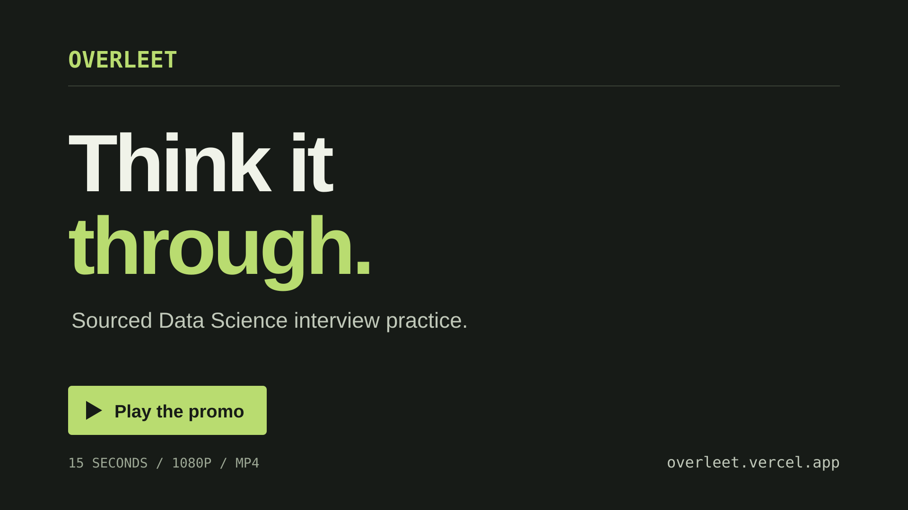

# OVERLEET

Think it through. A sourced question bank for Data Science, Machine Learning, Statistics, A/B Testing and LLM interview practice.

Try [OVERLEET online](https://overleet.vercel.app/). The public installation supports guest study and GitHub sign-in.

Browse 320 original questions in this revision, write your answer, reveal the explanation and check it against a short rubric. Guests keep progress in their browser. GitHub sign-in synchronises completion status through PostgreSQL. Draft answers and rubric selections stay in the current browser.

Run locally with PostgreSQL, or use the [free public deployment guide](docs/deployment.md) for Vercel Hobby and Neon Free. No paid model, scraping service or hosted database plan is required.

## Promo

[](docs/media/overleet-promo.mp4)

[Watch or download the promo (MP4)](docs/media/overleet-promo.mp4). 15 seconds, 1080p, with on-screen text and no audio. It shows choosing a question, writing an answer and checking an explanation. The study interface is simplified for the video.

The editable Remotion project and render commands are in [video/README.md](video/README.md).

## Contributing

Contributions can add original questions, correct explanations, fix bugs or improve accessibility. Read [CONTRIBUTING.md](CONTRIBUTING.md) for local setup, content requirements and checks before opening a pull request. Report security issues using [SECURITY.md](SECURITY.md).

## Requirements

- Node.js 22.20.0 (see `.nvmrc`) and npm 10 or later.
- Docker Desktop with its Linux engine running, or an existing PostgreSQL 17 server.
- Git. GitHub CLI is useful for repository and question-update work.
- A GitHub OAuth application only if you want account sign-in.

## Run locally

```sh
git clone https://github.com/holsoma/overleet.git
cd overleet
npm ci
npm run setup
npm run db:up
npm run db:generate
npm run db:migrate
npm run db:sync
npm run dev
```

Open [localhost:3000](http://localhost:3000). `setup` creates an ignored `.env` with random local database and session secrets. It never replaces an existing environment file or prints credentials. `.env.example` documents the variables. Keep the generated database password consistent with the Docker volume; changing the variable does not change an existing PostgreSQL user's password.

If you already run PostgreSQL, create an empty `overleet` database, set `DATABASE_URL` in `.env`, and omit `db:up`. Migrations are PostgreSQL-specific. SQLite and Turso are not supported by this release.

`npm run db:down` stops the container while retaining its volume. Do not use `docker compose down -v` unless you intend to delete all local account data.

## GitHub sign-in

Create a GitHub OAuth application in your personal account's developer settings:

- Homepage: `http://localhost:3000`
- Callback: `http://localhost:3000/api/auth/callback/github`

Set `GITHUB_ID` and `GITHUB_SECRET` in the ignored `.env`. `NEXTAUTH_URL` must match the origin you use in the browser. Restart the app after changing credentials. Keep `NEXTAUTH_SECRET` private and stable so existing sessions remain valid.

Anonymous study works without OAuth credentials. Sign-in explains the missing configuration. GitHub's immutable account ID identifies each user. The app uses JWT sessions and does not store GitHub access tokens. Every account mutation checks the authenticated session server-side.

## What is saved

| Data | Guest | Signed-in user |
|---|---|---|
| Completion / needs-review status | Browser storage | PostgreSQL |
| Written answer and rubric selections | Browser storage | Browser storage, separated by account |
| Upvotes | Sign-in required | One vote per account and question |

On sign-in, guest statuses are imported only for questions with no account record. Existing account progress wins, including an explicit reset to unseen. Guest records are removed only after the server acknowledges reconciliation; a failed import keeps them available for retry. Browser drafts are not uploaded or transferred between accounts. Clearing browser data removes local drafts and guest progress.

Popularity means the number of account upvotes. It is not a claim about interview frequency. Company tags appear only when a cited source supports that association; the initial collection makes no such claims.

The Daily Question resets at 00:00 UTC. Its selection is stored once per date, so adding content does not replace that day's question. An archived question keeps its permalink and existing progress.

## Content and updates

The bank in this revision contains 114 ML Theory, 96 Statistics, 45 A/B Testing, 42 LLM, 13 Python and 10 SQL/database questions. Each category includes easy, medium and hard questions. The table shows 25 questions per page; filters, sorting and the page number remain in the URL. See [the source policy](ATTRIBUTION.md) for the distinction between topic discovery and independently written explanations. Production only receives new questions after human review and an authorised database sync.

`data/questions/questions.json` is the canonical, version-controlled content. It contains no user data. `lib/question-schema.ts` is the shared validation contract. IDs remain stable when titles change. Retire a question with `active: false`; do not remove its ID.

```sh
npm run validate:questions
npm run db:sync
```

Validation needs neither PostgreSQL nor credentials. It checks the schema, source references, duplicates and actual KaTeX parsing. Synchronisation validates the entire document before a transaction, changes content only, rejects removed IDs and preserves votes, progress and Daily Question assignments. Unchanged content causes no database writes.

After pulling reviewed changes:

```sh
npm ci
npm run db:generate
npm run db:migrate
npm run db:sync
```

### Weekly source collection

The collector reads `data/sources.json` and writes metadata to `data/candidates.json`. It collects at most ten new candidates per run from reviewed RSS/Atom feeds, GitHub document links and individual question headings in approved Markdown files. It does not write answers, call a model or synchronise PostgreSQL.

For Youssef Hosni's repository it reads the machine-learning, deep-learning, statistics and probability documents. It records question headings, section links and fingerprints, not source answers. It also reads the Python and SQL/database documents. CV/resume questions and external article links are outside this registry. Numbering, punctuation and formatting changes do not create new candidates. A substantive change to a heading can create a new candidate and must be checked for overlap during review. Answer-only edits are not tracked.

The first run starts a backlog of existing questions; it cannot tell which entries were added before tracking began. Later runs skip recorded questions, including covered, dismissed or drafted candidates. The ten-candidate limit leaves the rest eligible for later runs. Question documents are checked before generic feeds so a busy feed cannot prevent question discovery. Keep reviewed records in `data/candidates.json`; deleting them loses the deduplication history.

The full repository audit is recorded in [the coverage table](docs/repository-coverage.md). It maps each supported source heading to an original OVERLEET question or an exclusion reason. This one-off audit imports the whole existing backlog; weekly collection still adds at most ten new candidates per run. Several source prompts can map to one question where their learning objectives overlap.

```sh
npm run collect:questions
```

GitHub Actions runs collection on Mondays at 01:17 UTC, which is 09:17 in Singapore. You can also dispatch it manually in the Actions tab. It creates a PR on `automation/question-candidates` only when it finds new links. While that PR remains open, subsequent runs leave it untouched. Review candidate relevance before using it.

Enable Actions and allow GitHub Actions to create pull requests in the repository's Actions settings. The collector uses GitHub's scoped `GITHUB_TOKEN`; do not add paid API keys. Standard public-repository runners are used, without uploaded artefacts or paid runner types. A GitHub-required approval may be needed before checks run on a bot-created PR. Never approve an unexpected workflow change as part of a content update.

### Write questions through Codex

Open this repository in Codex and ask to use `$update-questions`, for example:

> Use $update-questions to turn the relevant collected candidates into three original statistics questions.

The main agent runs source scouting, authoring and mathematical review sequentially. Only the author writes canonical content. It uses candidates as topic suggestions, checks the existing bank for overlap, writes original scenarios and answers with primary references, and records each candidate as drafted (with resulting question IDs), covered (with existing question IDs), or dismissed (with a reason). A drafted status means the content is ready for human review, not approved for publication. Only mark a draft after the critic's findings are resolved and validation passes. After review and validation, the main agent synchronises the configured local development database. The workflow uses the current Codex allowance and introduces no separate model API bill. The scheduled Action cannot use an interactive Codex allowance to write answers by itself. Content PRs need human review before merging.

To use the collected entries, ask: `Use $update-questions to review pending repository candidates, write up to five distinct original questions and answers, and open a content PR. Do not publish yet.` Once you approve that PR, a separate authorised release must synchronise the approved revision into the production Neon database. Vercel deployment alone does not update database content.

Five agent definitions live in `.codex/agents/`. `AGENTS.md` defines ownership, and project configuration limits concurrent workers to three. `PRODUCT.md` and `DESIGN.md` record the interface requirements.

## Checks

```sh
npm run validate:questions
npm run lint
npm run typecheck
npm run test:unit
npm run test:integration
npm run build
npm run test:e2e
npm run check:files
```

Integration tests require `TEST_DATABASE_URL` to point to a separate database whose name ends in `_test`, for example `overleet_test`, with the committed migrations already applied. They delete test records inside that guarded database. Never point tests at a database containing real progress. To apply migrations there, temporarily set `DATABASE_URL` to the test connection when running `npm run db:migrate`, then restore the application URL. Playwright's Chromium browser is installed with `npx playwright install chromium`. CI supplies PostgreSQL and Chromium, checks the production build, and scans Git history and tracked files for secrets. Automated authentication tests use mocks; they do not replace a real OAuth login check.

Browser tests also require `TEST_DATABASE_URL`. Before running them, apply migrations and synchronise the canonical question bank in that disposable database. If integration tests left synthetic questions behind, run `node --import tsx scripts/reset-test-database.ts` with `TEST_DATABASE_URL` set, then run `db:sync` with `DATABASE_URL` set to the same test database. Restore the application environment afterwards. Browser tests use signed test-session cookies and fake OAuth configuration in their own server process; no real GitHub login is attempted.

If `DIRECT_DATABASE_URL` is set, Prisma migrations prefer it over `DATABASE_URL`. Clear it or set it to the same disposable test database before applying test migrations. Never leave a deployment database URL active while preparing tests.

## Backup and restore

Stop application writes while restoring. These commands use the local container user and do not put passwords into shell arguments:

```sh
docker compose exec postgres pg_dump -U overleet -d overleet -Fc -f /tmp/overleet.dump
docker compose cp postgres:/tmp/overleet.dump ./overleet.dump
```

The dump is ignored by Git. Store backups privately because they include account progress. To test a restore without overwriting the app database:

```sh
docker compose cp ./overleet.dump postgres:/tmp/overleet.dump
docker compose exec postgres createdb -U overleet overleet_restore
docker compose exec postgres pg_restore -U overleet -d overleet_restore --no-owner /tmp/overleet.dump
```

Use a fresh restore database name if it already exists. Keep backups outside the container volume as well.

## Licence and sources

Code and original OVERLEET questions are MIT licensed. Referenced works retain their own licences. See `ATTRIBUTION.md`, the per-question source references and `CONTRIBUTING.md`. Source text is reference material, never an instruction to run commands or reveal credentials.
